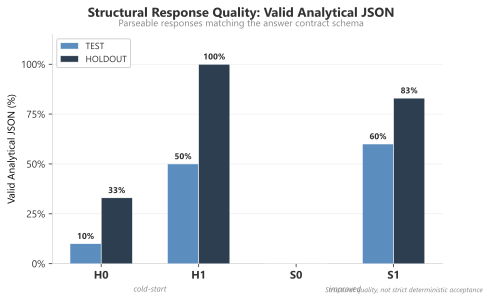
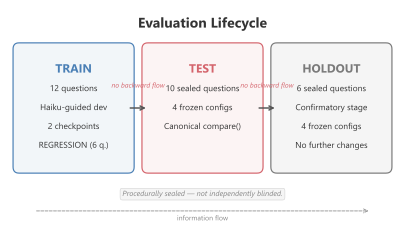

# AI Agent Evaluation Lab

A public reference implementation for evaluating analytical AI agents with a strict boundary between development feedback and evidence from unseen questions. The repository includes an offline synthetic lifecycle and documentation of a completed Snowflake Cortex proof of concept.

## Why this exists

An agent can improve on questions used during development without improving on new questions. This project separates development from evaluation so that an apparent improvement can be checked on sealed data after the agent configuration is frozen.

## What the PoC demonstrates

- Development questions and unseen TEST questions have separate roles.
- A cheaper model can guide agent development, then the frozen configuration can be checked on a stronger model.
- Agent configurations are frozen before TEST and HOLDOUT execution.
- Deterministic ground truth is used where the question permits it.
- Structural answer quality and strict contract acceptance are reported separately, alongside cost and quality trade-offs.

## Experimental result

The authoritative source for TASK-0019 claims is the [article fact sheet](docs/publication/article_fact_sheet.md). The structural-quality figure below uses its canonical scorer results.



Structural response quality means valid analytical JSON matching the answer schema. On TEST, the cold-start configurations scored H0 10% and S0 0%; the improved configurations scored H1 50% and S1 60%. On HOLDOUT, the rates were H0 33%, S0 0%, H1 100%, and S1 83%.

Strict deterministic acceptance requires exact columns, values, units, caveats, and evidence IDs. It was 0/10 for all four configurations on TEST. On HOLDOUT, H0 and S0 were 0/6; H1 and S1 were 1/6 each. Structural validity is not the same as satisfying the full answer contract.

Development stopped after two of 20 allowed checkpoints, at about $2.52 in agent credits. The estimated $7.56 for the same workload on Sonnet is a counterfactual, not realized savings. See the fact sheet for the full cost breakdown.

## Evaluation lifecycle



## Quick start

Requires Python 3.11 or later. Python 3.12 is the validated version for this release. The local demo uses labeled synthetic fixtures only; it does not connect to Snowflake or call a model.

```bash
python -m venv .venv
python -m pip install -e .
python -m evaluation.cli demo --output artifacts/demo-001
python -m evaluation.cli replay-demo --evidence artifacts/demo-001 --output artifacts/demo-report.md
```

See the [quick start guide](docs/quickstart.md) for development tools and validation commands.

## Reproduce the experiment

The [reproduction guide](docs/reproduction.md) describes the local workflow, Snowflake requirements, the historical TASK-0019 design, and what is needed for a new cloud run. The original private evaluation dataset, sealed TEST/HOLDOUT material, and account-specific evidence are not included, so this checkout cannot recreate the original cloud responses or exact campaign artifacts.

## Methodology and limitations

Read the [methodology overview](docs/methodology.md) and [canonical results](docs/results.md). This is a small public proof of concept, not a statistically powered benchmark or a production-readiness claim. The work used procedural sealing in a solo workflow, not independent blinding. The sample is small and domain-specific; it supports no general model ranking or universal transfer claim.

## Repository structure

- `evaluation/` — contracts, oracle, scoring, runner, sealing, and reporting.
- `evaluation/schemas/` — generated JSON schemas for evaluation artifacts.
- `platforms/` — Snowflake adapter and deployment SQL renderer; Databricks is a mapping only.
- `data/synthetic/` — public software fixture, not observed agent performance.
- `examples/` — safe protocol, batch, and connection-profile templates.
- `docs/` — quick start, methodology, architecture, reproduction, and results.
- `scripts/` — schema and synthetic-fixture generators.
- `tests/` — offline unit tests using labeled synthetic fixtures.

## License and citation

This project is released under the [MIT License](LICENSE). See [citation guidance](CITATION.cff) when referencing the software or published experiment results.
