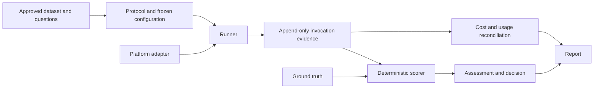

# Architecture

The repository separates platform-neutral evaluation logic from cloud adapters and keeps each evaluation artifact explicit and verifiable.

## Components

- `evaluation/contracts.py` defines portable questions, answers, ground truth, and adapter contracts.
- `evaluation/oracle.py`, `comparators.py`, and `scoring.py` validate releases and assess recorded responses.
- `evaluation/runner.py`, `sealing.py`, and `integrity.py` handle schedules, stage boundaries, write-once evidence, and verification.
- `evaluation/costs.py`, `reconciliation.py`, and `decisions.py` keep budget, attribution, and release logic explicit.
- `platforms/snowflake/` provides the Snowflake transport, fingerprinting, and SQL generation. The `render-snowflake` command writes SQL files but does not connect or execute them.
- `platforms/databricks/mapping.md` is a portability mapping, not a working Databricks adapter.

## Artifact boundaries

Frozen releases, question/truth files, protocols, schedules, configurations, and raw responses should be write-once. Assessments, reviews, usage reconciliation, and disclosures are separate records. Generated reports must be traceable to their inputs and must not replace them.

The public synthetic fixture is for software verification only. The original research dataset, sealed evaluation inputs, evaluator keys, account credentials, and restricted cloud traces are not distributed. Do not place those materials in the repository.

The local runner keeps split labels, ground truth, and review criteria out of invocation requests. The Snowflake adapter calls an explicitly versioned agent; the local replay adapter accepts only artifacts labeled `synthetic_fixture`.

## Related documentation

- [Methodology](methodology.md)
- [Canonical results](results.md)
- [Reproduction guide](reproduction.md)
- [Artifact schema generator](../scripts/build_schemas.py)
- [Snowflake deployment notes](deployment/snowflake.md)
