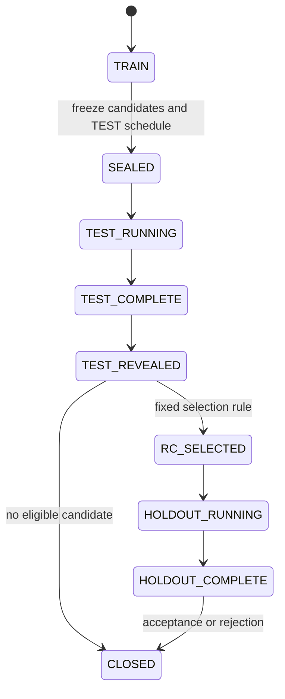

# Prospective protocol v1: reference lifecycle

This is the earlier R1-style reference protocol used by the generic runner. It describes two repetitions and a selected-candidate HOLDOUT stage. TASK-0019 used a separate one-shot 2×2 design with four configurations evaluated on TEST and HOLDOUT; see the [methodology overview](../methodology.md), [reproduction guide](../reproduction.md), and [results](../results.md).

This operationalizes the approved evaluation methodology. No new literature review
or continuation of the triathlon scientific study is part of this project.

## Frozen design

24 canonical German questions, six categories and two invocations per question.
Every category contributes two TRAIN, one TEST and one HOLDOUT question (12/6/6).
Missingness and scope/provenance questions are critical: 4/2/2 by split. Difficulty,
criticality, units, tolerance, expected ordering, oracle and review rubric are frozen
before any formal agent invocation. English translations are documentation-only.

Group paraphrases, translated pairs and entity-substitution variants under a shared
leakage_group_id; intent_id supports later multilingual paired testing. Do not
increase sample size by counting synthetic paraphrases as independent questions.
Synthetic augmentation is TRAIN-only and excluded from the primary denominator.

## Lifecycle and change boundaries

Inconclusive cost/review evidence defers a decision in TEST_REVEALED or
HOLDOUT_COMPLETE; it does not authorize more invocations. Complete pending
attribution/review, append a new assessment, then recompute the same rule.

| Stage | Permitted change | Inspectable results |
|---|---|---|
| A0 | Valid minimum agent, correct primitives, common answer contract | TRAIN |
| A1 | Semantic representation, descriptions, explicit measures and TRAIN examples | TRAIN |
| A2 | Instructions and descriptions of existing tools | TRAIN |
| A3, later wave | Model OR one runtime setting | Newly frozen protocol |
| TEST | None; all candidates already sealed | Reveal after whole batch finishes |
| HOLDOUT | None; one previously selected RC | Reveal after both repetitions |
| Release | Alias/routing assignment only | Completed evidence |

Data, business definitions, questions, truths, review rubric, output contract,
permissions, model and budgets stay fixed except for the declared intervention.
Use `validate_intervention` on canonical AgentSpec objects before sealing. Do not
combine a model change with prompt changes and attribute the result to the model.

A1 and A2 each get one proposal in the initial budget. Start the next proposal from
the last TRAIN-promoted configuration. Record rejected versions and actual parent
relationships. The renderer defaults A2 to A1; pass `--a2-parent A0` when A1 failed.
Generated templates are not an instruction to deploy all stages before TRAIN review.

## Frozen operational thresholds

A question regression is a reduction in its 0/2, 1/2 or 2/2 accepted count.
TRAIN blocks promotion on a new critical regression, more than one noncritical
robust-success loss, lower aggregate acceptance, p95 latency >90 s, or runtime
cost per accepted answer >USD 0.10 equivalent. Promotion also needs one additional
robust-success question OR >=15% cheaper cost/accepted with no acceptance/robust loss.

TEST requires >=10/12 accepted, 4/4 critical, complete accounting, p95 <=90 s and
runtime cost/accepted <=USD 0.10. No A0 critical regression or loss of an A0 2/2
question is permitted. Among eligible sealed candidates, choose most robust
questions, most accepted invocations, lowest cost/accepted, lowest median latency,
then earlier candidate ID. No eligible candidate means NO_RELEASE.

HOLDOUT evaluates only that RC on 6 questions twice. Require >=10/12 accepted,
4/4 critical and the same absolute cost/latency/integrity gates. Failure ends the
release attempt; do not test the runner-up. Report a failed release honestly.

These are pilot operational acceptance criteria, not significance or power claims.
Inspect question-level changes, critical results, error categories and costs together.
Report exploratory question/group-cluster bootstrap intervals; never treat 12 calls
as 12 independent stakeholder questions. With six hidden questions precision is low.

## Benchmark R1 amendment

[ADR-0004](../decisions/ADR-0004-benchmark-r1-campaign-amendment.md) governs the first
real aggregate P2 CORE campaign. It retains the lifecycle,
12/6/6 split, two repetitions, gates, custody, and selection rule, but uses four
candidates named V0-V3. V0 is the deliberately minimal baseline; V1 changes semantics;
V2 changes instructions and existing-tool descriptions; V3 permits one additional
instruction/existing-tool-description refinement based only on TRAIN. V2 and V3 each
use the last TRAIN-promoted parent. All four versions are sealed and compared on TEST.

R1 therefore schedules 96 TRAIN, 48 TEST, and 12 one-candidate HOLDOUT calls. Its
separate capability smoke test schedules one call. Native diagnostics and monitoring
are excluded from this smallest campaign. The USD 10 ceiling and USD 2 uncertainty
reserve are unchanged; insufficient funding stops the campaign instead of reducing
candidates, repetitions, or hidden sets.

## Execution and budget

Fresh conversation every invocation, two balanced repetitions, concurrency one,
no automatic retries or best-of selection. TEST interleaves configurations inside
question/repetition blocks with seed 20260919. Record platform routing/cache metadata
when available. Submitted failures stay in the denominator. An unsubmitted budget
stop makes the batch incomplete. Ambiguous submissions require reconciliation;
the runner never silently resubmits them.

The synthetic baseline remains 72 TRAIN + 36 TEST + 12 HOLDOUT = 120 calls, plus its
12 scripted monitoring calls. It is retained for software replay only. Campaign R1
uses the amended counts above. Do not drop a poor candidate after TEST results arrive.

Before each batch record a fresh trial balance, expiry, rate-card hash, conservative
per-invocation bound, warehouse overhead, judge estimate, outstanding reservations
and funding needed to finish hidden evaluation. Hard scheduling target: USD 10
equivalent, including USD 2 reserve; never upgrade the trial. Metering can lag and
does not provide an atomic invoice cap. Stop rather than invent a zero cost.

Runtime cost/accepted includes all failed and successful invocations plus allocated
SQL warehouse overhead. Keep evaluation, setup and monitoring overhead separate in
the full experiment total. Unknown attribution blocks cost-dependent release gates.
Native correctness/judge scores are supplemental, version-pinned and never override
deterministic failures or add repetitions to primary metrics.

## Monitoring and claim boundaries

Use a bounded TRAIN-derived replay only after promotion. Capture critical failures,
two unsuccessful calls in a six-request batch, p95 breaches, fingerprint drift and
budget/accounting failures. Alert/suspend or route to a previously approved bundle;
do not auto-tune prompts. A new fix belongs to a new experiment.

The local demo splits six TRAIN intents into two six-request batches (three intents,
two repetitions each). This exercises monitoring plumbing; it does not estimate
temporal drift or production reliability. All latency/cost values in it are fixtures.

Managed model backends may change despite a stable model name. Record requested and
observed identifiers and pinning limitations. Controlled sequential configuration
changes do not by themselves establish causal component effects.
